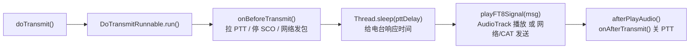
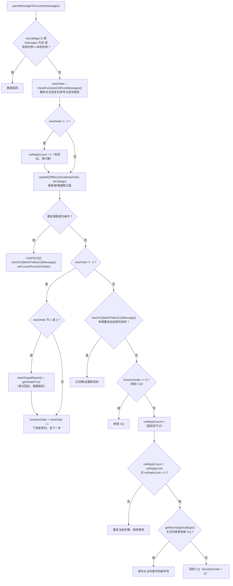
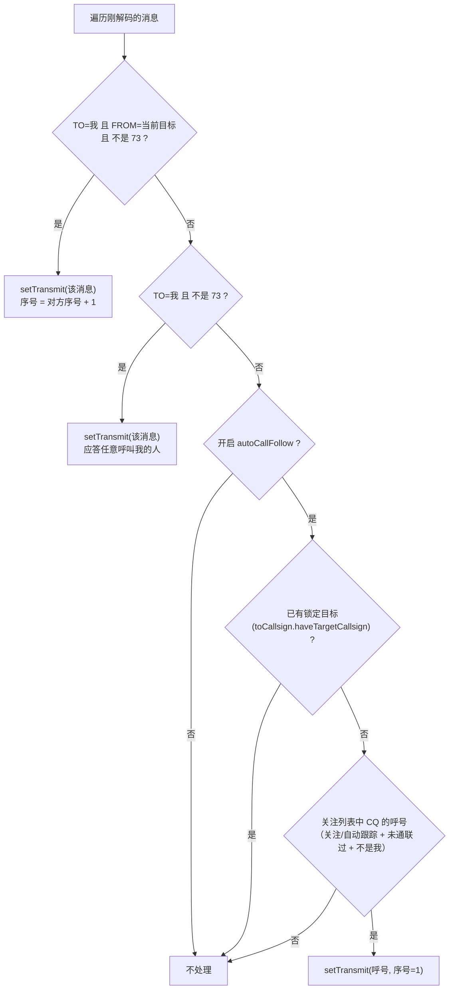
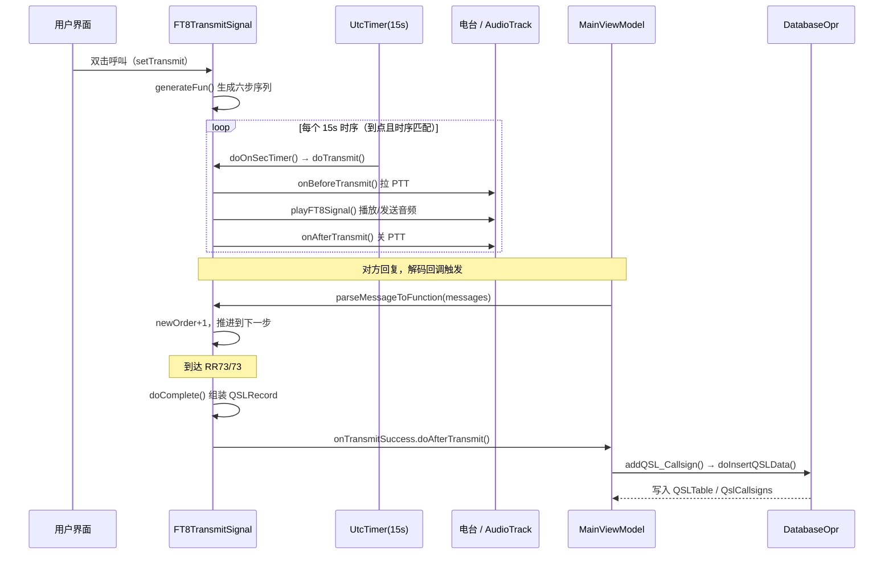

# FT8CN QSO 系统说明（状态机与自动流程）

> 本文只聚焦 QSO 系统的**六步状态机**与**自动通联流程**，说明发射如何被驱动、收到对方消息后如何推进、何时判定通联成功、以及无回应时如何防卡死。
> 数据落库、第三方上传、UI 展示等只做必要交代，不展开。
> 代码基准：`ft8cn/app/src/main/java/com/bg7yoz/ft8cn/`

---

## 1. 涉及的核心类

| 类 | 文件 | 职责 |
|---|---|---|
| `FT8TransmitSignal` | `ft8transmit/FT8TransmitSignal.java` | **状态机核心**：六步序列、自动应答、时序控制、成功判定 |
| `FunctionOfTransmit` | `ft8transmit/FunctionOfTransmit.java` | 单条待发消息（序号 / 内容 / 是否完成 / 是否当前） |
| `TransmitCallsign` | `ft8transmit/TransmitCallsign.java` | 目标呼号及其频率、SNR、时序 |
| `GenerateFT8` | `ft8transmit/GenerateFT8.java` | 消息文本 → FT8 音频 |
| `Ft8Message` | `Ft8Message.java` | 解码出的消息对象（呼号 / 网格 / 报告 / 时序） |
| `GeneralVariables` | `GeneralVariables.java` | 六步判定的正则（`checkFun1..5` / `checkFunOrder`）、关注呼号、无回应计数 |
| `MainViewModel` | `MainViewModel.java` | 解码回调、发射回调（PTT / 网络 / SCO） |
| `DatabaseOpr` | `database/DatabaseOpr.java` | 通联成功后写 `QSLTable` / `QslCallsigns` |

---

## 2. 六步协议

`FunctionOfTransmit` 的注释即「FT8通联的6步」，消息内容由 `FT8TransmitSignal.getFunctionCommand(order)` 生成：

| 序号 | 消息格式 | 含义 | 触发的场景 |
|:---:|---|---|---|
| 6 | `CQ MYCALL GRID` | 我 CQ | 主动发起 |
| 1 | `TOCALL MYCALL GRID` | 回复网格 | 对方在 CQ |
| 2 | `TOCALL MYCALL -10` | 信号报告 | 对方抄了我的网格 |
| 3 | `TOCALL MYCALL R-10` | 确认收到报告 | 对方给了报告 |
| 4 | `TOCALL MYCALL RR73` | 收到确认 | 对方发了 R-报告 |
| 5 | `TOCALL MYCALL 73` | 结束 | 对方发了 RR73 |

对方的回复属于哪一步，由 `GeneralVariables.checkFunOrder(Ft8Message)` 反解：
先判 `checkFun5`（73）→ `checkFun4`（RR73）→ `checkFun3`（R-\d+）→ `checkFun2`（-\d+）→ `checkFun1`（4 位网格），返回对应序号，否则 `-1`。

---

## 3. 状态机的关键状态量

`FT8TransmitSignal` 内部的私有字段就是状态：

| 字段 | 含义 |
|---|---|
| `toCallsign` | 当前目标呼号（`TransmitCallsign`） |
| `functionOrder` | **当前该发第几步**（1~6） |
| `sequential` | 本机发射时序（0/1），每设置一次呼叫就翻转 |
| `activated` | 是否允许发射 |
| `isTransmitting` | 是否正在发射 |
| `sendReport` / `sentTargetReport` | 我给对方的信号报告 |
| `receivedReport` / `receiveTargetReport` | 对方给我的信号报告 |
| `messageStartTime` / `messageEndTime` | 通联起止时间（用于生成记录） |
| `functionList` | 生成的待发序列项 |

对外通过 `MutableLiveData` 通知界面：`mutableToCallsign`、`mutableFunctionOrder`、`mutableSequential`、`mutableIsActivated`、`mutableIsTransmitting`、`mutableFunctions`、`mutableTransmittingMessage`。

---

## 4. 两个驱动源

状态机本身不主动跑，靠两个事件驱动：

### 4.1 定时器（发射节拍）

构造 `FT8TransmitSignal` 时启动 `UtcTimer`（`FT8Common.FT8_SLOT_TIME_M`，15 秒一个 slot）：

```java
// FT8TransmitSignal 构造，doOnSecTimer
if (GeneralVariables.isLaunchSupervisionTimeout()) {   // 自动监管超时
    setActivated(false);
    return;
}
if (UtcTimer.getNowSequential() == sequential && activated
        && GeneralVariables.myCallsign.length() >= 3) {
    doTransmit();   // 到点就发射；音频延迟另算
}
```

`doTransmit()` 交给线程池执行 `DoTransmitRunnable`：



### 4.2 解码回调（推进节拍）

`MainViewModel.afterDecode()` 每解出一批消息就尝试推进状态机（注意两个抑制条件：正在发射、深度解码都不触发）：

```java
if (!ft8TransmitSignal.isTransmitting()
        && !isDeep
        && (ft8SignalListener.timeSec + pttDelay + transmitDelay <= 2000)) {
    ft8TransmitSignal.parseMessageToFunction(messages);
}
```

---

## 5. 状态机主流程 `parseMessageToFunction()`

这是整个 QSO 系统的大脑（`FT8TransmitSignal.java:808`）。



### 5.1 解析对方回复 `checkFunctionOrdFromMessages()`

遍历消息（倒序），过滤掉：同一时序的消息、`toCallsign` 为空。只认「`TO=我` 且 `FROM=当前目标`」的消息，然后：

- 若报告类消息（`checkFun3` / `checkFun2`）→ 记录 `receivedReport / receiveTargetReport`；同时记录 `sendReport = 该消息的 snr`；
- 返回 `GeneralVariables.checkFunOrder(消息)` 作为 `newOrder`。

### 5.2 通联成功判定（`FT8TransmitSignal.java:832`）

满足下面**任一**即判定成功，随后 `resetToCQ()` 回到 CQ 状态：

| 条件 | 说明 |
|---|---|
| `newOrder == 5` | 对方回了我 73 |
| `functionOrder == 5 && newOrder == -1` | 我已发 73，对方无回应 |
| `functionOrder == 4 && noReplyCount > noReplyLimit*2 && noReplyLimit > 0` | 我发 RR73 后长时间无回应，且设置了无回应限制 |
| `functionOrder == 4 && checkTargetCallMe() > 1` | 我发 RR73 后，对方开始呼叫别人了 |
| `functionOrder == 4 && noReplyCount > 20 && noReplyLimit == 0` | 无回应限制设为「忽略」时的兜底复位 |

> `checkTargetCallMe()` 返回 0=目标在呼叫我，1=没有目标的消息，>1=目标在呼叫别人。

### 5.3 成功后的落库（简述）

`updateQSlRecordList()` 的 `case 4 / 5` 里，第一次到达就调用 **`doComplete()`**：

`doComplete()` 组装 `QSLRecord` → 回调 `OnTransmitSuccess.doAfterTransmit()` → `MainViewModel` 中：

1. `databaseOpr.addQSL_Callsign(record)` → `AddQSL_Info`(AsyncTask) → `doInsertQSLData()`，写 `QSLTable`（正式日志）与 `QslCallsigns`（去重通联列表）；
2. 新线程上传 Cloudlog / QRZ；
3. 查询 DXCC / ITU / CQ 分区并累加（点亮地图）。

（表结构、ADIF 导出不在本文范围。）

---

## 6. 自动应答与自动跟踪 `checkCQMeOrFollowCQMessage()`

当没有对上当前目标的进度时，状态机会尝试「被动接单」，优先级如下（`FT8TransmitSignal.java:673`）：



要点：

- 第一段循环**优先**处理「我的目标 CQ 我」，避免多台同时呼叫我时回复不专一；
- 只有在 `autoCallFollow` 开启且当前没有锁定目标时，才会去关注/自动跟踪列表里「抢 CQ」；
- `setTransmit()` 内部会把 `sequential = (目标时序 + 1) % 2`，即**对方的下一拍**回话，并重新 `generateFun()` 生成六步序列。

---

## 7. 一次典型通联的时序



---

## 8. 防卡死与边界处理小结

| 机制 | 位置 | 作用 |
|---|---|---|
| `noReplyCount` + `noReplyLimit` | `parseMessageToFunction` | 长时间无回应就复位到 CQ 或换目标 |
| RR73 多种兜底条件 | 成功判定分支 | 对方呼叫别人 / 无回应超 20 次 / 超阈值，都强行收尾 |
| `checkTargetCallMe()` | 成功判定 | 目标改叫别人时把本次通联判为结束 |
| `getNewTargetCallsign()` | 超时分支 | 优先切到关注列表里新的 CQ，而不是空转 CQ |
| `isLaunchSupervisionTimeout()` | `doOnSecTimer` | 自动监管超时自动停止发射 |
| `myCallsign.length() < 3` 校验 | `doTransmit` / `setTransmitting` | 呼号非法时不发射 |
| WSPR-2 频率保护 | `doTransmit` | 命中 WSPR-2 频点直接禁用发射 |
| 时序/波段/排除字头过滤 | `isExcludeMessage` | 只解析与本机相关、同波段、非排除呼号的消息 |

---

## 9. 关键方法索引（便于定位）

| 方法 | 位置 | 说明 |
|---|---|---|
| `parseMessageToFunction()` | `FT8TransmitSignal.java:808` | 状态机主入口 |
| `checkFunctionOrdFromMessages()` | `FT8TransmitSignal.java:604` | 解析对方回复序号/报告 |
| `checkCQMeOrFollowCQMessage()` | `FT8TransmitSignal.java:673` | 自动应答与自动跟踪 |
| `updateQSlRecordList()` | `FT8TransmitSignal.java:753` | 更新记录，4/5 步触发落库 |
| `doComplete()` | `FT8TransmitSignal.java:475` | 生成并提交 QSL 记录 |
| `setTransmit()` / `generateFun()` | `FT8TransmitSignal.java:199 / 293` | 设置目标并生成六步序列 |
| `getFunctionCommand()` | `FT8TransmitSignal.java:251` | 六步消息内容 |
| `resetToCQ()` / `resetTargetReport()` | `FT8TransmitSignal.java:1005 / 996` | 复位状态 |
| `getNewTargetCallsign()` | `FT8TransmitSignal.java:911` | 超时后在关注列表找新目标 |
| `doOnSecTimer()` | `FT8TransmitSignal.java:126` | 定时发射节拍 |
| `DoTransmitRunnable` | `FT8TransmitSignal.java:1047` | 单次发射的执行体 |
